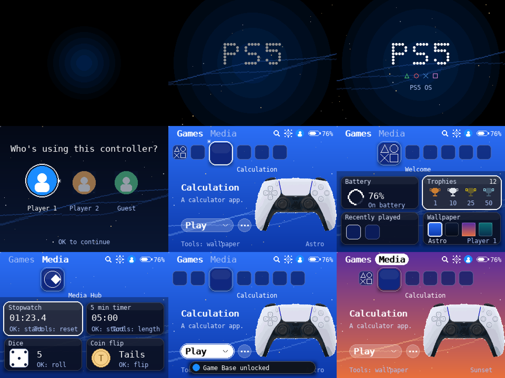

# PS5-OS pour NumWorks

PS5-OS remplace l'écran d'accueil de la NumWorks (**n0110**, **n0115** ou **n0120**) par un
menu façon **PlayStation 5** : animation de démarrage, choix du profil, onglets
*Games* / *Media*, ruban d'icônes avec anneau lumineux, bouton *Play*, deux hubs de
widgets et une vraie manette DualSense en fond d'écran.

Projet perso, sans lien avec Sony ni NumWorks. Il est basé sur le moteur de dessin et
l'installateur de **Windows-OS** (derim00), sous licence **CC BY-NC-SA 4.0** : garde le
fichier `LICENSE`, ne vends rien, et ne publie pas le firmware compilé (il contient du
code NumWorks sous licence non commerciale).

Il s'installe dans le **slot B** : ton système officiel (slot A) n'est pas touché.
Reset au dos de la calculatrice = retour au système officiel.

*(aperçu simulé sur PC, pas une capture de la calculatrice)*

## Démarrage

1. **Animation PS5** (3,4 s) : lueur bleue, logo « PS5 », symboles, poussière dorée. Une touche la saute.
2. **« Who's using this controller? »** : Gauche/Droite choisit le profil, OK valide. Chaque profil a sa couleur d'avatar et son fond d'écran de départ.
3. L'accueil apparaît en fondu.

## Utilisation (flèches uniquement)

| Touche | Action |
|---|---|
| Flèches | Se déplacer (barre du haut, ruban, bas de l'écran) |
| OK / EXE | Valider |
| Toolbox | Action secondaire (change le fond, remet à zéro un widget…) |
| Back / Home | Revient au ruban, puis à la première icône |

**Barre du haut** : onglets *Games* et *Media*, loupe (lance la Calculatrice), engrenage
(Réglages), avatar (retour au choix du profil), batterie avec pourcentage.

**Ruban** : la première icône est le *Welcome Hub*, puis les applis de la calculatrice.
Sur une appli : titre, bouton **Play** (lance l'appli) et bouton **...** (change le fond
d'écran : Astro, Midnight, Sunset, Aurora).

**Welcome Hub** (4 widgets) : *Battery* (anneau, OK = pourcentage / tension), *Trophies*
(coupes Bronze, Argent, Or, Platine débloquées selon le nombre de lancements, Toolbox =
remise à zéro), *Recently played* (OK = relance la dernière appli), *Wallpaper*
(OK = fond suivant).

**Media Hub** (onglet *Media*) : *Stopwatch* (OK départ / arrêt, Toolbox remise à zéro),
*Timer* (OK départ / pause, Toolbox change la durée : 1, 5, 10, 25 min), *Dice* (OK lance),
*Coin flip* (OK lance).

## Jeux cachés

Les jeux `.nwa` n'apparaissent **pas** dans le menu. Tape ce code sur l'écran d'accueil :

**↑ ↑ ↓ ↓ ← → ← →**

Un message « Game Base unlocked » s'affiche et les jeux rejoignent le ruban. Le même code
les recache. Au redémarrage de la calculatrice, ils sont de nouveau cachés.

## Installer

1. Crée un dépôt GitHub **privé** avec le contenu de ce dossier (bouton *Use this template* → *Private* si ce dépôt est un modèle).
2. Mets tes jeux `.nwa` dans `games/` (facultatif, voir `games/LISEZMOI.md`).
3. Onglet **Actions** → *Build PS5-OS* → *Run workflow* → modèle **n0110**, **n0115** ou **n0120** (la n0115 se compile comme une n0110).
4. Télécharge l'installateur (*PS5-OS-Windows* ou *PS5-OS-Mac*), branche la calculatrice, appuie sur **Reset** au dos, clique sur *Installer*.

## Fichiers

- `patches/ps5-os-epsilon.patch` : le menu (`epsilon/apps/home/win/shell.cpp`). Le dossier
  garde le nom `win/` pour réutiliser le moteur de dessin de Windows-OS.
- `scripts/build-ps5-os.sh` : compile le firmware à partir des sources officielles d'Epsilon.
- `installer/` : l'installateur (page web animée + serveur local).
- Les widgets, l'animation de démarrage et le code secret sont dans `shell.cpp`.

## Notes

- La manette en fond d'écran est une image réduite (160×104, 16 couleurs) intégrée au code.
  Si tu publies ce dépôt, vérifie que tu as le droit de redistribuer cette image.
- L'écran fait 320×240 et l'interface se rafraîchit environ toutes les 0,3 s : les
  animations sont donc par paliers, pas fluides comme sur une vraie PS5.
- Pas d'horloge interne sur la NumWorks : la batterie remplace l'heure en haut à droite.
- Non testé sur une vraie calculatrice : si la compilation ou l'installation échoue, donne le message d'erreur.
